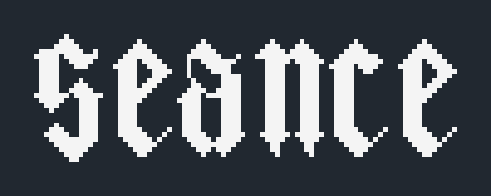
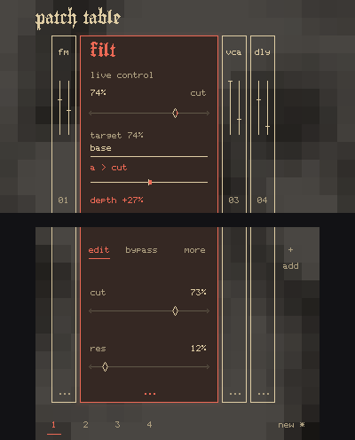
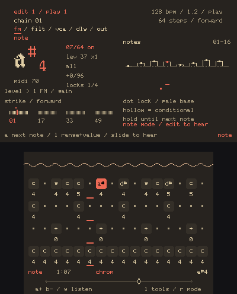
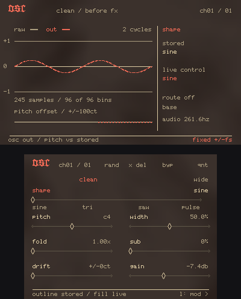

**a modular sequencer and live instrument for Nintendo 3DS.**

record sounds, reshape samples, draw modulation and build evolving rhythms.
start with an oscillator, a WAV or the microphone; chain processors, sequence
the result, then mix, morph and switch patterns while it plays.

- **33 modules** for synthesis, sampling, live input, recording and effects, including
  [five coupled oscillators](GUIDE.md#pent), [generative sample notes](GUIDE.md#rule),
  [decaying tape loops](GUIDE.md#rot), [scratch/hold](GUIDE.md#scrt) and [spectral stretching](GUIDE.md#paul).
- **four audio chains**, each with up to six modules to combine and reorder.
- **eight LFOs (sigils)** with hand-drawn shapes, generated waveforms and tempo sync.
- **four sequencer tracks**, up to 64 steps, eight banks, parameter locks and slices.
- **live recording and resampling**: record the microphone or processed chains, bounce the mix and export WAVs.
- **performance controls**: a four-channel mixer, A/B sound morphing, live FX and a 16-card bank order.

[user guide & installation](GUIDE.md) · [module reference](GUIDE.md#module-reference) · [build from source](BUILDING.md) · [changelog](CHANGELOG.md)

gallery

| patch table | sequencer |
| :---: | :---: |
|  |  |

native-host demo renders, not console captures · [full gallery](assets/artwork/ui/README.md)

## status

`0.1.0-alpha.1` · homebrew · work in progress.
this source update keeps the alpha version; it is not a new binary release.

**Old 3DS has not been tested. performance on older models is unknown.**
New 3DS uses its CPU speedup; demanding patches can still exceed the audio budget.
relic is temporarily removed after reported performance problems; its code is
archived, not redesigned. projects containing relic refuse safely without changing
their files.
a binary release still needs the matching runtime/source review described in the
[notices](THIRD_PARTY_NOTICES.md); this source update is not legal or device clearance.

## license

[GPL-3.0-or-later](LICENSE). fonts, audio and other assets have their own
[terms and credits](THIRD_PARTY_NOTICES.md). independent homebrew, not an official
Nintendo product.
