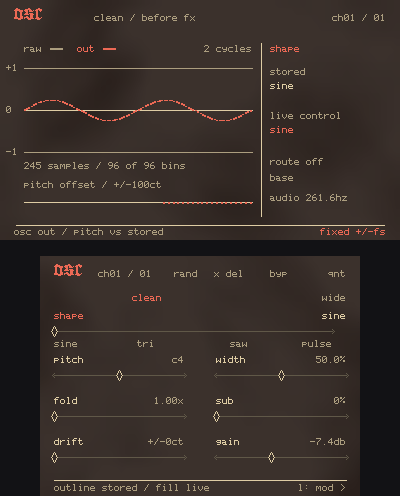
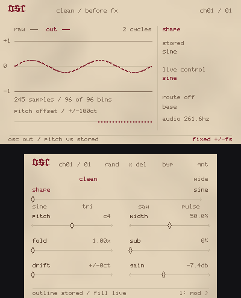
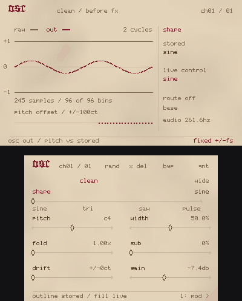
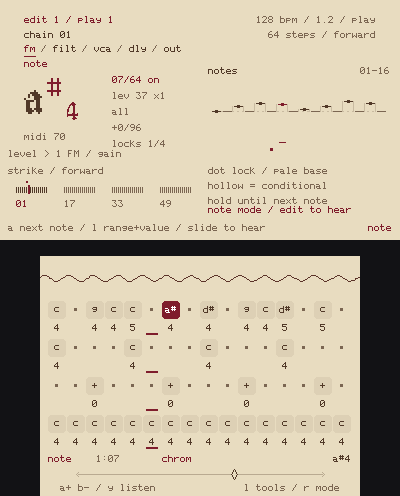
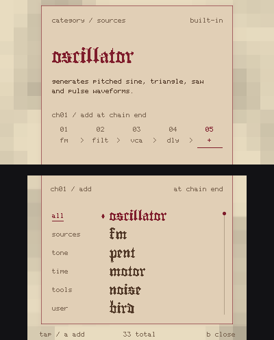
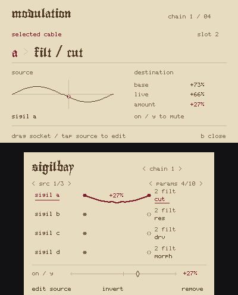
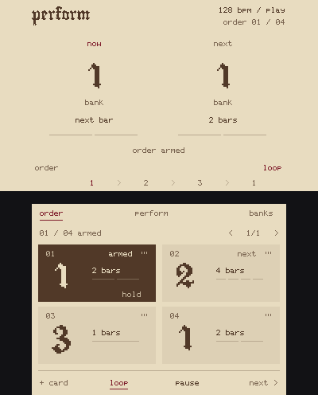
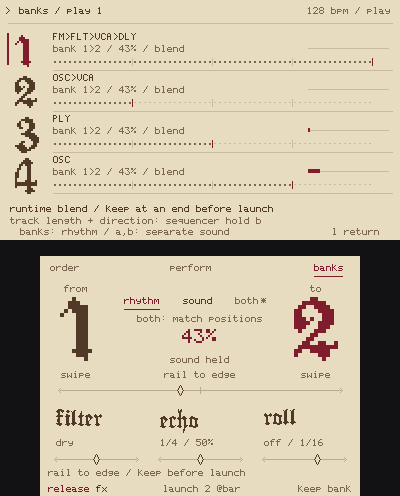
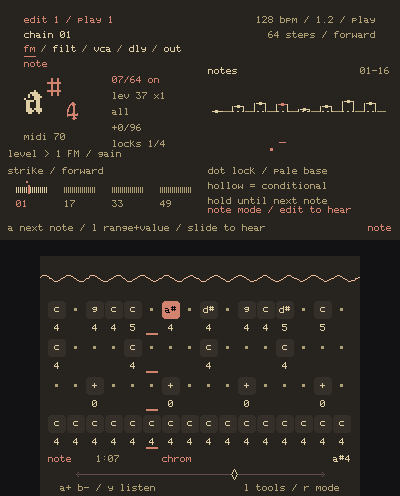

# interface gallery

[back to seance](../../../README.md#interface) · [user guide](../../../GUIDE.md)

these are native-host renders of the current C++ interface, using demo scenes,
synthetic audio and the bundled fonts and artwork. they are not console
photographs, recordings of live interaction, or evidence of hardware speed or
sound. no private projects or recordings are included.

each paired view is 400×496 pixels: a 400×240 upper screen and a centered 320×240
lower screen, separated by 16 pixels. PNGs keep the native-host colours; GIFs use
a compressed palette. click an image to inspect it at its original size.

## modules

all 33 available module editors, half a second per module; 16.5 seconds per loop.
these are slideshows of still views, not animations of an individual module.
relic is reserved and unavailable, so it is not included.

### black mass

old grimoire and alternating shipped themes

### old grimoire

### alternating themes

old grimoire → black mass → pink → gray, changing between modules.

### individual stills

these PNGs all use black mass. open any module without waiting for the slideshow.

| sources and sampling | processors | more processors and instruments |
| --- | --- | --- |
| [osc](modules/01_osc.png) | [fold](modules/12_fold.png) | [fract](modules/23_fract.png) |
| [noise](modules/02_noise.png) | [bit](modules/13_bit.png) | [comp](modules/24_comp.png) |
| [fm](modules/03_fm.png) | [chorus](modules/14_chorus.png) | [mouth](modules/25_mouth.png) |
| [motor](modules/04_motor.png) | [strn](modules/15_strn.png) | [arp](modules/26_arp.png) |
| [play](modules/05_play.png) | [rev](modules/16_rev.png) | [glitch](modules/27_glitch.png) |
| [gran](modules/06_gran.png) | [ghost](modules/17_ghost.png) | [inst](modules/28_inst.png) |
| [mic](modules/07_mic.png) | [ring](modules/18_ring.png) | [scrt](modules/29_scrt.png) |
| [rec](modules/08_rec.png) | [tilt](modules/19_tilt.png) | [paul](modules/30_paul.png) |
| [filter](modules/09_filter.png) | [strain](modules/20_strain.png) | [pent](modules/31_pent.png) |
| [vca](modules/10_vca.png) | [shift](modules/21_shift.png) | [rule](modules/32_rule.png) |
| [delay](modules/11_delay.png) | [bird](modules/22_bird.png) | [rot](modules/33_rot.png) |

## main screens

fourteen views in old grimoire. the patch-table and sequencer previews on the
[main README](../../../README.md#interface) use black mass.

| sequencer notes | triggers and flow |
| :---: | :---: |
|  |  |

| held-r layer selector | held-b bank panel |
| :---: | :---: |
|  |  |

| parameter-lock target | performance mixer |
| :---: | :---: |
|  |  |

| startup menu | patch table |
| :---: | :---: |
|  |  |

| go to | module picker |
| :---: | :---: |
|  |  |

| sigils | sigilbay |
| :---: | :---: |
|  |  |

| bank order | bank transition |
| :---: | :---: |
|  |  |

## palette study

four shipped themes plus ten custom combinations drawn only from the existing
theme picker's swatches. violet, moss, bone-blue, wine, ice, amber, blue-night,
linen, rose and sage are study labels, **not ten new built-in presets**. the
interface and demo scene stay the same between colour changes.

### still overviews

**rapid colour changes:** the two GIFs below switch light and dark backgrounds
every 100 milliseconds. use the still overviews if you are sensitive to flashing.

show fast palette GIFs — 100 ms per palette

each GIF has 14 frames, a 1.4-second loop and infinite repeat.

## terms and scope

the images retain the bundled typefaces and interface artwork's existing
[terms and credits](../../../THIRD_PARTY_NOTICES.md). this gallery does not
change the application, saved theme, audio, version or binary release.
