# gallery

[seance](../../../README.md) · [guide](../../../GUIDE.md) · [credits](../../../THIRD_PARTY_NOTICES.md)

modules

other palettes

old grimoire

old grimoire → black mass → pink → gray

module stills

| sources and sampling | processors | more processors and instruments |
| --- | --- | --- |
| [osc](modules/01_osc.png) | [fold](modules/12_fold.png) | [fract](modules/23_fract.png) |
| [noise](modules/02_noise.png) | [bit](modules/13_bit.png) | [comp](modules/24_comp.png) |
| [fm](modules/03_fm.png) | [chorus](modules/14_chorus.png) | [mouth](modules/25_mouth.png) |
| [motor](modules/04_motor.png) | [strn](modules/15_strn.png) | [arp](modules/26_arp.png) |
| [play](modules/05_play.png) | [rev](modules/16_rev.png) | [glitch](modules/27_glitch.png) |
| [gran](modules/06_gran.png) | [ghost](modules/17_ghost.png) | [inst](modules/28_inst.png) |
| [mic](modules/07_mic.png) | [ring](modules/18_ring.png) | [scrt](modules/29_scrt.png) |
| [rec](modules/08_rec.png) | [tilt](modules/19_tilt.png) | [paul](modules/30_paul.png) |
| [filter](modules/09_filter.png) | [strain](modules/20_strain.png) | [pent](modules/31_pent.png) |
| [vca](modules/10_vca.png) | [shift](modules/21_shift.png) | [rule](modules/32_rule.png) |
| [delay](modules/11_delay.png) | [bird](modules/22_bird.png) | [rot](modules/33_rot.png) |

screens

| sequencer notes | triggers and flow |
| :---: | :---: |
|  |  |

| held-r layer selector | held-b bank panel |
| :---: | :---: |
| 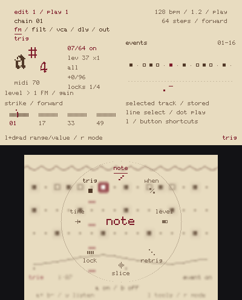 | 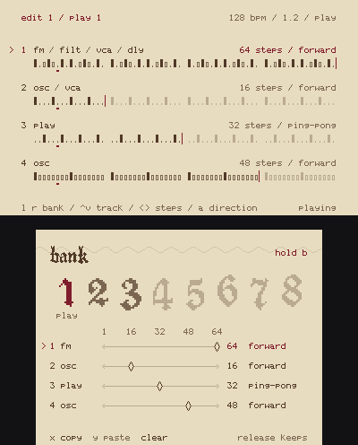 |

| parameter-lock target | performance mixer |
| :---: | :---: |
| 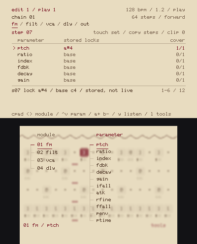 | 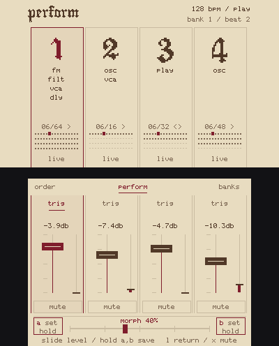 |

| startup menu | patch table |
| :---: | :---: |
| 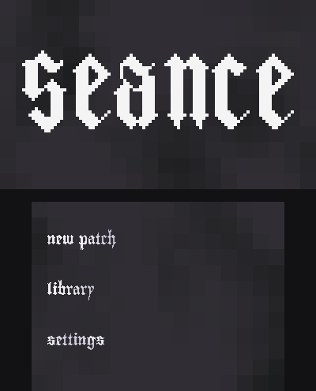 | 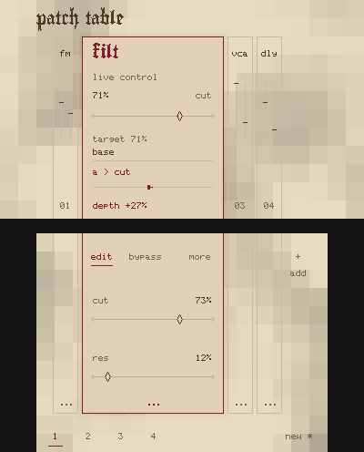 |

| go to | module picker |
| :---: | :---: |
| 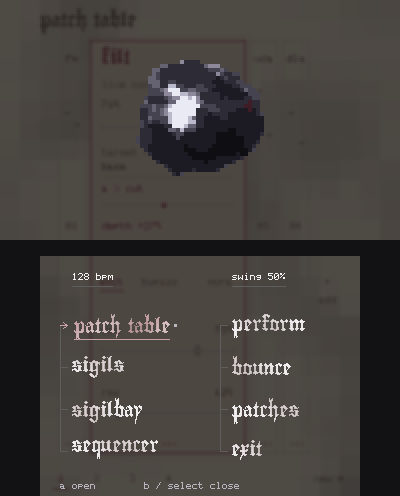 |  |

| sigils | sigilbay |
| :---: | :---: |
| 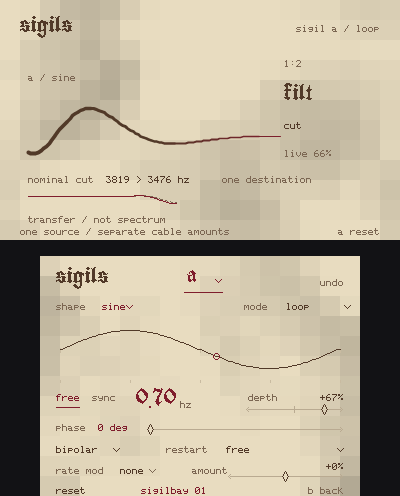 |  |

| bank order | bank transition |
| :---: | :---: |
|  |  |

palettes

custom palettes from the theme picker's swatches.

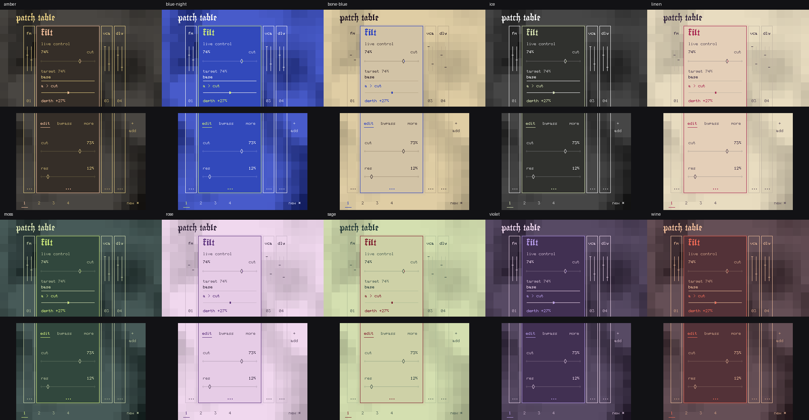

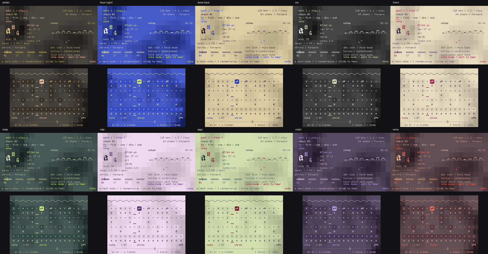

**flashing:** fast loops switch backgrounds every 100 ms. use the stills if sensitive.

fast loops

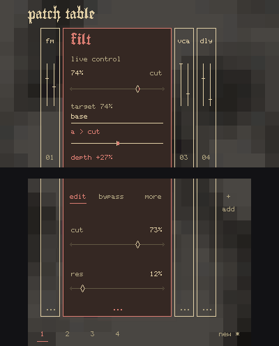

